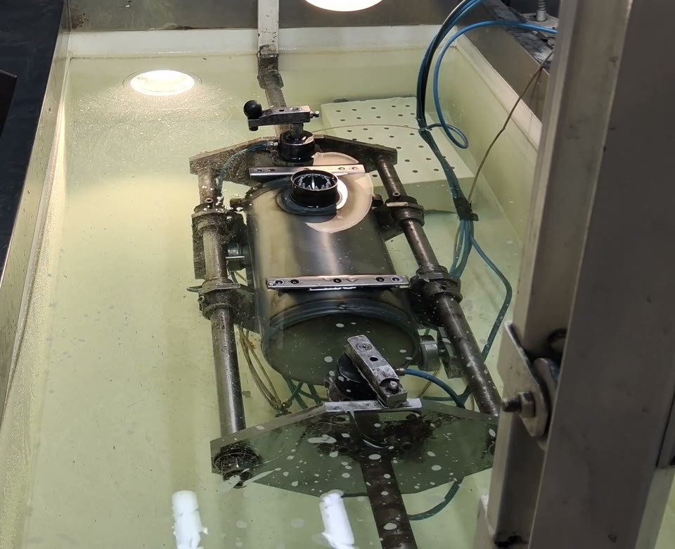
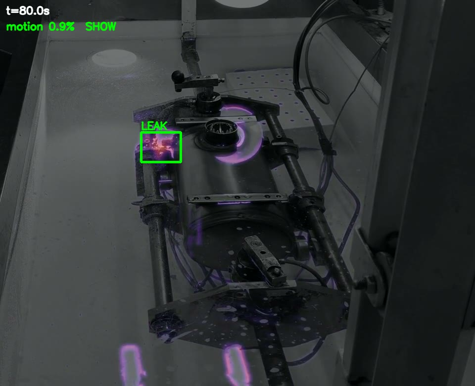
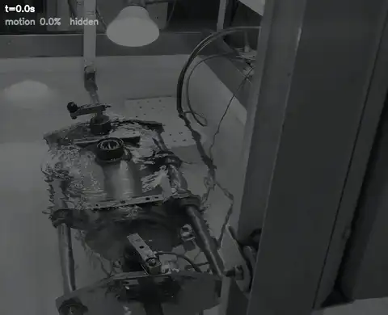
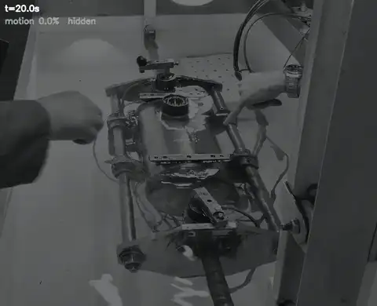
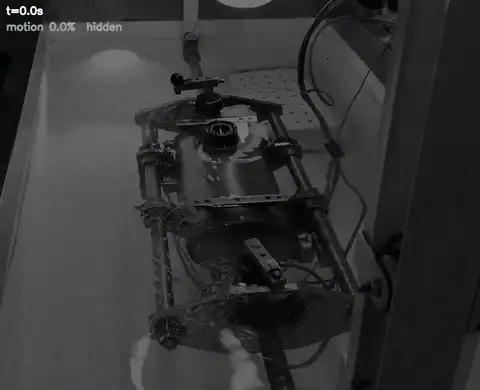
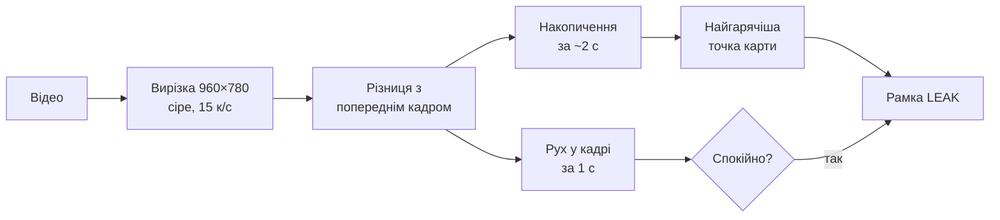

<div align="center">

# spheros

**Автоматичний пошук місця витоку на відео випробування у ванні з водою**


[Демо](#демо) · [Як це працює](#як-це-працює) · [Запуск](#запуск) · [Структура](#структура) · [Обмеження](#обмеження)

</div>

| Вхідне відео | Результат |
|:---:|:---:|
|  |  |

Вузол занурений у ванну з водою. Якщо в ньому є витік, з цього місця піднімаються бульбашки.
Програма аналізує відео й позначає зеленою рамкою **LEAK** місце, де картинка змінюється найстабільніше, тобто найімовірніше місце витоку.

Рамка з'являється лише тоді, коли в кадрі спокійно, і ховається, коли хтось тягнеться руками до вузла або по воді йдуть хвилі.

## Демо

<table>
  <tr>
    <th>A · запис 125707</th>
    <th>B · запис 125707</th>
    <th>C · запис 124646</th>
  </tr>
  <tr>
    <td><a href="media/demo/125707_leak_5x.mp4"></a></td>
    <td><a href="media/demo/125707_from20s_leak_5x.mp4"></a></td>
    <td><a href="media/demo/124646_leak_5x.mp4"></a></td>
  </tr>
  <tr>
    <td align="center">0:00–1:55 запису<br><a href="media/demo/125707_leak_5x.mp4">▶ mp4, 23 с</a></td>
    <td align="center">0:20–1:25 запису<br><a href="media/demo/125707_from20s_leak_5x.mp4">▶ mp4, 13 с</a></td>
    <td align="center">6:27–8:36 запису<br><a href="media/demo/124646_leak_5x.mp4">▶ mp4, 26 с</a></td>
  </tr>
</table>

Усі відео прискорені в 5 разів. Натисніть на прев'ю, щоб відкрити повне відео.

A і B зроблені з одного запису, але з різною ділянкою кадру і різним стартом. Тому вхідних кліпів два, а демо три.

**Як читати відео**

| Що на екрані | Що означає |
|---|---|
| Кольорова карта | де в кадрі довго й стабільно щось змінюється; чим яскравіше, тим стабільніше |
| Зелена рамка `LEAK` | найгарячіша точка карти, тобто ймовірне місце витоку |
| `motion X%` | яка частка кадру змінилася за останню секунду |
| `SHOW` / `hidden` | рамка показана або схована, бо в кадрі рух |

## Як це працює



1. **Вирізка.** З кадру береться ділянка 960×780 з вузлом і водою навколо, у сірому, 15 кадрів на секунду.
2. **Зміна.** Піксель вважається зміненим, якщо його яскравість відрізняється від попереднього кадру на 15 рівнів або більше.
3. **Накопичення.** Зміни накопичуються з пам'яттю приблизно 2 с: `E = 0.967·E + 0.033·зміна`.
   Потік бульбашок іде безперервно, тому він «підгоряє» на карті, а короткі мерехтіння згасають.
4. **Рамка.** Рамка 80×60 px ставиться на найгарячішу точку карти й плавно за нею рухається.
5. **Правило спокою.** Рамка з'являється, коли рух у кадрі менше 3% протягом 2 с. Вона зникає, коли рух більше 4.5% протягом 1 с.

## Запуск

Потрібні Python 3.10+ і [FFmpeg](https://ffmpeg.org/download.html) (`ffmpeg` і `ffprobe` мають бути в `PATH`).

```bash
pip install -r requirements.txt
python make_demos.py
```

`make_demos.py` бере кліпи з `media/input/` і заново створює всі демо в `media/demo/` та прев'ю в `media/preview/`. На звичайному ноутбуці це займає 2–3 хвилини.

**Своє відео**

```bash
python leak_detector.py my_video.mp4 result.mp4 --crop 640 300
```

`--crop X Y` задає лівий верхній кут ділянки 960×780, яку треба аналізувати. Наведіть її на вузол так, щоб у неї потрапила вода навколо.

<details>
<summary><b>Усі параметри <code>leak_detector.py</code></b></summary>

| Параметр | Що робить |
|---|---|
| `--crop X Y` | лівий верхній кут вирізки 960×780 (за замовчуванням `640 300`) |
| `--start С` | з якої секунди відео почати |
| `--duration С` | скільки секунд обробити |
| `--csv файл` | записати стан по кадрах: час, рух у %, чи показана рамка, центр рамки |

Результат має розмір 960×780, 30 к/с і ту саму тривалість, що й вхід.

Пороги алгоритму задаються константами на початку файлу:

| Що | Значення | Константа |
|---|---|---|
| Поріг зміни яскравості | 15 рівнів | `THR` |
| Пам'ять накопичення | ~2 с | `LAM` |
| Поріг спокою / руху | 3% / 4.5% | `CALM_ON`, `CALM_OFF` |
| Скільки чекати спокою / руху | 2 с / 1 с | `ON_FR`, `OFF_FR` |
| Розмір рамки | 80×60 px | `BOX_HALF_W`, `BOX_HALF_H` |

</details>

## Структура

```
spheros/
├── leak_detector.py                 детектор: відео → відео з картою і рамкою LEAK
├── make_demos.py                    відтворює всі демо з media/input/
├── requirements.txt
└── media/
    ├── input/                       вхідні кліпи, 1920×1080, 15 к/с
    │   ├── 125707_0000-0155.mp4     запис 125707, 0:00–1:55
    │   └── 124646_0627-0836.mp4     запис 124646, 6:27–8:36
    ├── demo/                        результати, прискорені в 5 разів
    └── preview/                     анімовані прев'ю і кадри для цього README
```

| Демо | Вхідний кліп | Старт у кліпі | Вирізка (x, y) |
|---|---|---|---|
| A | `125707_0000-0155.mp4` | 0 с | 800, 200 |
| B | `125707_0000-0155.mp4` | 20 с | 640, 300 |
| C | `124646_0627-0836.mp4` | 0 с | 640, 300 |

<details>
<summary><b>Як зроблені вхідні кліпи</b></summary>

Сирі записи (3840×2160, 30 к/с, кілька ГБ) у репозиторій не входять. Кліпи вирізано з них так:

```bash
ffmpeg -ss 0   -i 20260526_125707.mp4 -t 115 -vf "fps=15,scale=1920:1080:flags=lanczos" \
       -c:v libx264 -preset slow -crf 23 -pix_fmt yuv420p -an media/input/125707_0000-0155.mp4
ffmpeg -ss 387 -i 20260526_124646.mp4 -t 129 -vf "fps=15,scale=1920:1080:flags=lanczos" \
       -c:v libx264 -preset slow -crf 23 -pix_fmt yuv420p -an media/input/124646_0627-0836.mp4
```

15 к/с достатньо, бо програма й так аналізує відео з такою частотою.

</details>

## Обмеження

- **Відблиски.** Відблиски на стійках і металі теж потрапляють на карту, і рамка іноді переходить на них.
- **Рух у кадрі.** Руки й хвилі на воді вимикають рамку. Якщо хвилі не зупиняються, рамка може не з'явитися взагалі.
- **Затримка.** Рамка з'являється на 1–2 с пізніше, бо рух усереднюється за минулу секунду.
- **Ручна вирізка.** Ділянку кадру для кожного запису задано вручну.
